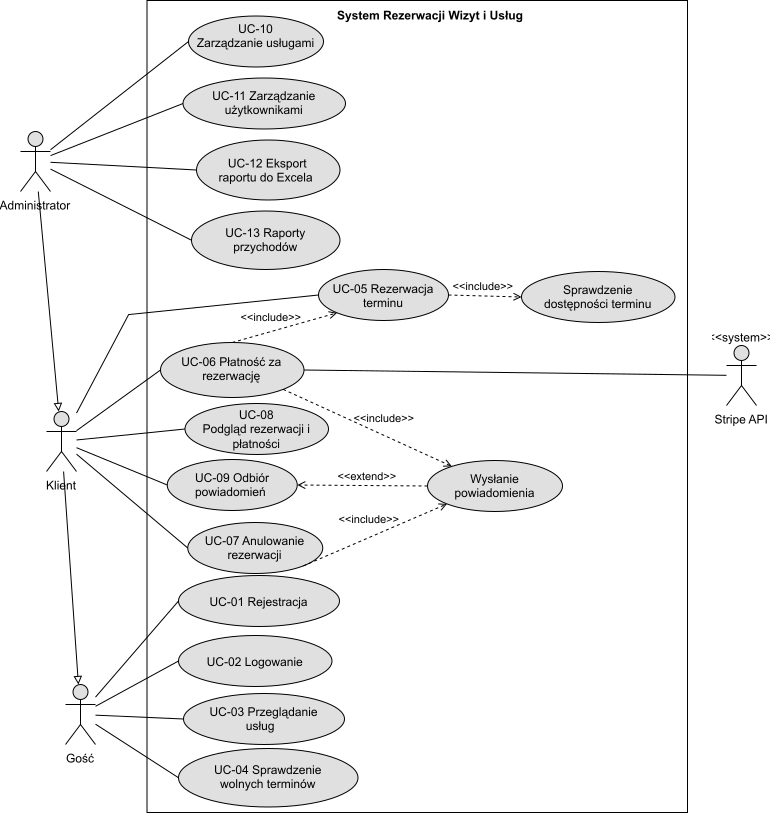
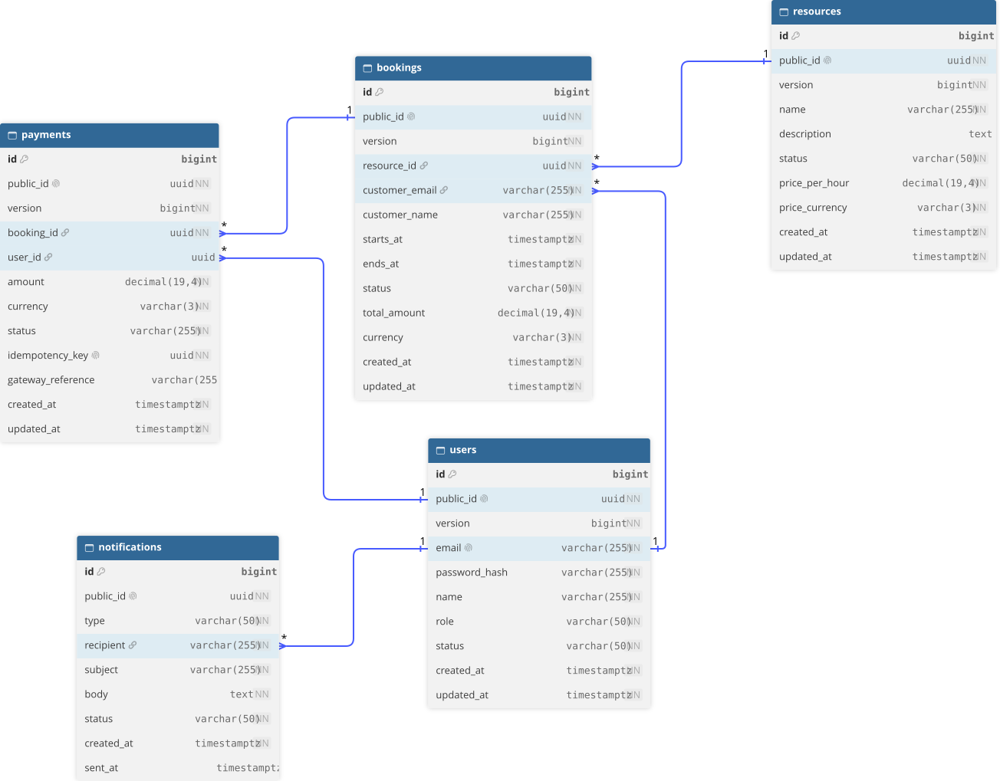

# System rezerwacji wizyt i usług - dokumentacja projektu

Przedmiot: Technologie backendowe \
Uczelnia: WSPA w Lublinie \
Autor: Maksym Korshun \
Repozytorium: https://github.com/kzhunmax/booking

Technologie: Java 25, Spring Boot 4.1, Spring Data JPA, PostgreSQL, Flyway, Spring Security + JWT, Springdoc (Swagger), Log4j2, WebSocket (STOMP), Apache POI, Stripe API, Gradle.

## Spis treści

1. Cel i opis aplikacji
2. Wymagania funkcjonalne i niefunkcjonalne
3. Aktorzy i przypadki użycia
4. Najważniejsze obiekty w systemie
5. Kontrolery i komunikacja HTTP
6. Baza danych
7. Zrzut bazy danych
8. Spełnienie wymagań z zadania
9. Uruchomienie i budowanie

---

## 1. Cel i opis aplikacji

Aplikacja to backend (REST API) do rezerwowania wizyt i usług, np. u lekarza, w salonie fryzjerskim albo w gabinecie fizjoterapii. Klient rejestruje się, wybiera usługę, rezerwuje termin i płaci kartą przez Stripe. Administrator zarządza ofertą i użytkownikami oraz pobiera raport w Excelu.

Najważniejsze problemy, które aplikacja rozwiązuje:

- dwie osoby nie mogą zarezerwować tego samego terminu u tej samej usługi (pilnuje tego baza danych),
- ponowione żądanie płatności (np. po zerwaniu połączenia) nie obciąży karty drugi raz,
- po zmianie statusu rezerwacji aplikacja wysyła powiadomienie przez WebSocket i e-mail,
- administrator może wyeksportować rezerwacje do pliku `.xlsx`.

### Budowa aplikacji

Projekt jest jednym wdrażanym programem (monolit), ale kod jest podzielony na pięć modułów:

| Moduł          | Za co odpowiada                                              |
|----------------|--------------------------------------------------------------|
| `auth`         | rejestracja, logowanie, tokeny JWT, użytkownicy i ich status |
| `resource`     | usługi / zasoby, które można rezerwować, wraz z ceną         |
| `booking`      | rezerwacje, wolne terminy, raport Excel                      |
| `payment`      | płatności i integracja ze Stripe                             |
| `notification` | powiadomienia (WebSocket i e-mail)                           |

W każdym module jest podobny podział na pakiety: klasy publiczne modułu (serwis, odpowiedzi DTO, wyjątki) oraz pakiet `internal` z podpakietami `web` (kontrolery), `application` (logika), `domain` (encje) i `infrastructure` (repozytoria). Moduły korzystają ze sobą tylko przez publiczne interfejsy (np. `BookingService`). Te zasady sprawdzają testy ArchUnit.

Moduły komunikują się też zdarzeniami Springa: `BookingService` publikuje `BookingConfirmedEvent` i `BookingCancelledEvent`, a moduł `notification` je odbiera (po zatwierdzeniu transakcji, asynchronicznie).

---

## 2. Wymagania

### 2.1. Wymagania funkcjonalne

| Nr    | Wymaganie                | Opis                                                                                                                                                                                                                 |
|-------|--------------------------|----------------------------------------------------------------------------------------------------------------------------------------------------------------------------------------------------------------------|
| FR-01 | Rejestracja i logowanie  | Użytkownik zakłada konto (e-mail, imię, hasło) i loguje się. W odpowiedzi dostaje token JWT. Hasło musi mieć min. 8 znaków, małą i dużą literę, cyfrę i znak specjalny.                                              |
| FR-02 | Role                     | Są dwie role: `CUSTOMER` (klient) i `ADMIN`. Administrator może zablokować konto (`BLOCKED`), zablokowany użytkownik nie zaloguje się.                                                                               |
| FR-03 | Zarządzanie usługami     | Administrator dodaje usługę (nazwa, opis, cena za godzinę, waluta), edytuje nazwę i opis, zmienia status (`ACTIVE`, `INACTIVE`, `ARCHIVED`) i archiwizuje usługę.                                                    |
| FR-04 | Lista usług              | Każdy (także bez logowania) może przeglądać usługi. Domyślnie widać tylko aktywne. Lista jest stronicowana.                                                                                                          |
| FR-05 | Wolne terminy            | Dla wybranej usługi i dnia aplikacja zwraca przedziały czasu, które nie są zajęte.                                                                                                                                   |
| FR-06 | Rezerwacja               | Zalogowany klient rezerwuje usługę na przedział czasu (`startsAt`, `endsAt`). Termin musi być w przyszłości, a koniec po początku. Cena = cena za godzinę × czas trwania. Rezerwacja startuje ze statusem `PENDING`. |
| FR-07 | Płatność                 | Klient płaci za rezerwację w statusie `PENDING`. Aplikacja wywołuje Stripe, zapisuje płatność, a po udanej płatności zmienia rezerwację na `CONFIRMED`.                                                              |
| FR-08 | Idempotentność płatności | Żądanie płatności wymaga nagłówka `Idempotency-Key` (UUID). Powtórzenie z tym samym kluczem zwraca wcześniejszy wynik zamiast drugiej płatności.                                                                     |
| FR-09 | Anulowanie               | Właściciel rezerwacji lub administrator może ją anulować, ale najpóźniej 2 godziny przed startem. Zakończonej (`COMPLETED`) rezerwacji nie można anulować.                                                           |
| FR-10 | Powiadomienia            | Po potwierdzeniu i anulowaniu rezerwacji aplikacja wysyła wiadomość na kanał WebSocket `/topic/bookings` oraz e-mail do klienta. E-maile są zapisywane w tabeli `notifications`.                                     |
| FR-11 | Podgląd danych           | Klient widzi tylko swoje rezerwacje i płatności, administrator wszystkie. Listy można filtrować (usługa, status, daty).                                                                                              |
| FR-12 | Raport Excel             | Administrator pobiera plik `.xlsx` z listą rezerwacji (opcjonalne filtry: daty i status) oraz sumą kwot na końcu.                                                                                                    |
| FR-13 | Raporty przychodów       | Administrator pobiera sumę przychodów i przychód na usługę w wybranym okresie (zapytania JPQL) oraz ranking najlepiej zarabiających usług (natywne zapytanie SQL).                                                   |

### 2.2. Wymagania niefunkcjonalne

| Nr     | Obszar           | Opis                                                                                                                                                                                                       |
|--------|------------------|------------------------------------------------------------------------------------------------------------------------------------------------------------------------------------------------------------|
| NFR-01 | Bezpieczeństwo   | Uwierzytelnianie tokenem JWT (bezstanowo, bez sesji). Hasła są przechowywane jako hash (domyślnie BCrypt, `DelegatingPasswordEncoder`). Endpointy administratora mają `@PreAuthorize("hasRole('ADMIN')")`. |
| NFR-02 | Spójność danych  | Wersjonowanie rekordów (`@Version`) chroni przed jednoczesną edycją. Unikalny klucz idempotentności i ograniczenie `EXCLUDE` w bazie chronią przed duplikatami.                                            |
| NFR-03 | Logowanie        | Logi przez Log4j2: konsola oraz plik `logs/app.log` z rotacją (codziennie lub po 10 MB, archiwa `.gz`, max 30 plików).                                                                                     |
| NFR-04 | Profile          | Profil `dev` (lokalna baza, dane w pliku) i `prod` (dane z zmiennych środowiskowych, wyłączony Swagger).                                                                                                   |
| NFR-05 | Dokumentacja API | Swagger UI generowany przez Springdoc, z opisami endpointów, kodów odpowiedzi i autoryzacji JWT.                                                                                                           |
| NFR-06 | Obsługa błędów   | Wszystkie błędy zwracane są jako `ProblemDetail` (RFC 7807) przez klasy `@RestControllerAdvice`.                                                                                                           |
| NFR-07 | Jakość kodu      | Spotless (formatowanie), Checkstyle, Error Prone, JaCoCo, testy jednostkowe, integracyjne (Testcontainers) i architektoniczne (ArchUnit). Jest też workflow GitHub Actions.                                |
| NFR-08 | Migracje bazy    | Struktura bazy jest tworzona skryptami Flyway (`src/main/resources/db/migration`), a Hibernate tylko z niej korzysta (`ddl-auto: none`).                                                                   |

---

## 3. Aktorzy i przypadki użycia

### 3.1. Aktorzy

| Aktor         | Opis                                                                                                                                                                                                                                                    |
|---------------|---------------------------------------------------------------------------------------------------------------------------------------------------------------------------------------------------------------------------------------------------------|
| Gość          | Osoba niezalogowana. Może się zarejestrować, zalogować, oglądać usługi i sprawdzać wolne terminy.                                                                                                                                                       |
| Klient        | Zalogowany użytkownik z rolą `CUSTOMER`. Ma wszystko to, co gość, a ponadto rezerwuje, płaci, anuluje i widzi swoje dane.                                                                                                                               |
| Administrator | Użytkownik z rolą `ADMIN`. Ma uprawnienia klienta, widzi dane wszystkich użytkowników oraz zarządza usługami i użytkownikami, a także pobiera raporty. Pierwsze konto administratora tworzy aplikacja przy starcie na podstawie ustawień `app.admin.*`. |
| Stripe        | Aktor zewnętrzny, system płatności. Aplikacja wysyła do niego żądanie obciążenia karty i dostaje wynik oraz identyfikator płatności.                                                                                                                    |

### 3.2. Przypadki użycia

| Kod   | Nazwa                          | Aktor                 | Opis                                                                                                                          |
|-------|--------------------------------|-----------------------|-------------------------------------------------------------------------------------------------------------------------------|
| UC-01 | Rejestracja                    | Gość                  | Podanie e-maila, imienia i hasła. Jeśli e-mail jest wolny, powstaje konto `CUSTOMER`.                                         |
| UC-02 | Logowanie                      | Gość                  | Podanie e-maila i hasła, w odpowiedzi token JWT.                                                                              |
| UC-03 | Przeglądanie usług             | Gość, Klient          | Lista usług z cenami albo szczegóły jednej usługi.                                                                            |
| UC-04 | Sprawdzenie wolnych terminów   | Gość, Klient          | Podanie usługi i dnia, w odpowiedzi lista wolnych przedziałów.                                                                |
| UC-05 | Rezerwacja terminu             | Klient                | Wybór usługi i przedziału czasu. System sprawdza, czy termin jest wolny, i zapisuje rezerwację jako `PENDING`.                |
| UC-06 | Płatność za rezerwację         | Klient                | Podanie rezerwacji i klucza idempotentności. System wywołuje Stripe, zapisuje płatność i przy sukcesie potwierdza rezerwację. |
| UC-07 | Anulowanie rezerwacji          | Klient, Administrator | Zmiana statusu na `CANCELLED` (najpóźniej 2 godziny przed startem).                                                           |
| UC-08 | Podgląd rezerwacji i płatności | Klient, Administrator | Lista i szczegóły. Klient widzi tylko swoje, administrator wszystkie.                                                         |
| UC-09 | Odbiór powiadomień             | Klient, Administrator | Połączenie z `/ws` i subskrypcja `/topic/bookings`. Wiadomość przychodzi po potwierdzeniu lub anulowaniu rezerwacji.          |
| UC-10 | Zarządzanie usługami           | Administrator         | Dodawanie, edycja, zmiana statusu i archiwizacja usług.                                                                       |
| UC-11 | Zarządzanie użytkownikami      | Administrator         | Lista użytkowników, blokowanie i odblokowywanie kont.                                                                         |
| UC-12 | Eksport raportu do Excela      | Administrator         | Pobranie pliku `.xlsx` z rezerwacjami.                                                                                        |
| UC-13 | Raporty przychodów             | Administrator         | Suma przychodów i podział na usługi w okresie oraz ranking usług według przychodu.                                            |

### 3.3. Diagram przypadków użycia


---

## 4. Najważniejsze obiekty w systemie

| Obiekt                       | Opis                                                                                                                                                                                           | Ważne pola                                                                                                                                                        |
|------------------------------|------------------------------------------------------------------------------------------------------------------------------------------------------------------------------------------------|-------------------------------------------------------------------------------------------------------------------------------------------------------------------|
| `User`                       | Konto użytkownika.                                                                                                                                                                             | `publicId`, `email` (unikalny), `passwordHash`, `name`, `role` (`CUSTOMER`, `ADMIN`), `status` (`ACTIVE`, `BLOCKED`)                                              |
| `Resource`                   | Usługa lub zasób, który można rezerwować (lekarz, gabinet, zabieg).                                                                                                                            | `publicId`, `name`, `description`, `status` (`ACTIVE`, `INACTIVE`, `ARCHIVED`), `pricePerHour`, `currency`                                                        |
| `Booking`                    | Rezerwacja terminu u danej usługi. Zawiera reguły: termin w przyszłości, anulowanie najpóźniej 2 h przed startem, dozwolone przejścia statusów.                                                | `resourcePublicId`, `customerEmail`, `customerName`, `startsAt`, `endsAt`, `status` (`PENDING`, `CONFIRMED`, `CANCELLED`, `COMPLETED`), `totalAmount`, `currency` |
| `Payment`                    | Próba płatności za rezerwację.                                                                                                                                                                 | `bookingId`, `userId`, `amount`, `currency`, `status` (`PENDING`, `SUCCEEDED`, `FAILED`, `REFUNDED`), `idempotencyKey`, `gatewayReference`                        |
| `Notification`               | Zapis wysłanego e-maila.                                                                                                                                                                       | `type` (`BOOKING_CONFIRMED`, `BOOKING_CANCELLED`), `recipient`, `subject`, `body`, `status` (`PENDING`, `SENT`, `FAILED`), `sentAt`                               |
| `AuditInfo`                  | Klasa osadzana (`@Embeddable`) w encjach `User`, `Resource`, `Booking` i `Payment`. Trzyma `createdAt` i `updatedAt`, uzupełniane automatycznie.                                               |                                                                                                                                                                   |
| `BookingNotificationPayload` | Obiekt wysyłany przez WebSocket.                                                                                                                                                               | `eventType`, `bookingId`, `customerEmail`, `customerName`, `timestamp`                                                                                            |
| DTO (rekordy)                | Obiekty żądań i odpowiedzi, np. `BookingResponse`, `PaymentResponse`, `ResourceResponse`, `UserResponse`, `CreateBookingRequest`. Są to `record`-y Javy, więc nie zmieniają się po utworzeniu. |                                                                                                                                                                   |

Encje mają dwa identyfikatory: wewnętrzny `id` (liczba) i `publicId` (UUID). Na zewnątrz, w API, używany jest tylko `publicId`, żeby nie dało się zgadywać kolejnych numerów rekordów.

---

## 5. Kontrolery i komunikacja HTTP

### 5.1. Konwencje

1. Adnotacje Swaggera i mapowania adresów (`@GetMapping` itp.) są w interfejsach (`BookingApi`, `PaymentApi`, `ResourceApi`, `AuthApi`, `UserApi`). Kontrolery (`BookingController` itd.) tylko implementują te interfejsy i wywołują serwisy, dzięki czemu klasy kontrolerów są krótkie.
2. Żądania i odpowiedzi to rekordy Javy (`*Request`, `*Response`). Dane wejściowe są walidowane adnotacjami (`@NotBlank`, `@Email`, `@Size`, `@DecimalMin` itd.).
3. Adresy mają postać `/api/{rzeczowniki w liczbie mnogiej}` i używają `publicId`, np. `/api/resources/{publicId}`. Operacje, które nie pasują do CRUD, to dodatkowe segmenty, np. `POST /api/bookings/{publicId}/cancel`.
4. Przy tworzeniu zasobu (`201`) odpowiedź ma nagłówek `Location`.
5. Błędy mają zawsze format `ProblemDetail` z polami `type`, `title`, `status`, `detail` (i często `timestamp`). Wyjątki są mapowane w klasach `@RestControllerAdvice` w każdym module oraz w `GlobalExceptionHandler`.
6. Chronione endpointy wymagają nagłówka `Authorization: Bearer <token>`. Aktualnego użytkownika kontrolery dostają przez `@AuthenticationPrincipal SecurityUser`.
7. Listy zwracają `Page<...>` (parametry `page`, `size`, `sort`).

Publicznie dostępne (bez tokena) są: `/api/auth/register`, `/api/auth/login`, `GET /api/resources/**`, `GET /api/bookings/available-slots`, Swagger oraz `/ws/**`. Pozostałe adresy wymagają logowania.

### 5.2. Endpointy

#### Uwierzytelnianie i użytkownicy

| Metoda | Adres                          | Kto        | Żądanie                   | Odpowiedź            | Opis                      |
|--------|--------------------------------|------------|---------------------------|----------------------|---------------------------|
| POST   | `/api/auth/register`           | każdy      | `RegisterRequest`         | `UserResponse` (201) | rejestracja               |
| POST   | `/api/auth/login`              | każdy      | `LoginRequest`            | `AuthResponse` (200) | logowanie, zwraca token   |
| GET    | `/api/auth/me`                 | zalogowany | –                         | `UserResponse`       | profil zalogowanego       |
| GET    | `/api/users`                   | admin      | paginacja                 | `Page<UserResponse>` | lista użytkowników        |
| PATCH  | `/api/users/{publicId}/status` | admin      | `UpdateUserStatusRequest` | `UserResponse`       | blokowanie / odblokowanie |

#### Usługi (zasoby)

| Metoda | Adres                              | Kto   | Żądanie                                  | Odpowiedź                | Opis                                          |
|--------|------------------------------------|-------|------------------------------------------|--------------------------|-----------------------------------------------|
| GET    | `/api/resources`                   | każdy | `status` (domyślnie `ACTIVE`), paginacja | `Page<ResourceResponse>` | lista usług                                   |
| GET    | `/api/resources/{publicId}`        | każdy | –                                        | `ResourceResponse`       | szczegóły                                     |
| POST   | `/api/resources`                   | admin | `CreateResourceRequest`                  | `ResourceResponse` (201) | nowa usługa                                   |
| PUT    | `/api/resources/{publicId}`        | admin | `UpdateResourceRequest`                  | `ResourceResponse`       | zmiana nazwy i opisu                          |
| PATCH  | `/api/resources/{publicId}/status` | admin | `UpdateStatusRequest`                    | `ResourceResponse`       | zmiana statusu                                |
| DELETE | `/api/resources/{publicId}`        | admin | –                                        | brak (204)               | archiwizacja (usługa nie jest usuwana z bazy) |

#### Rezerwacje

| Metoda | Adres                             | Kto                | Żądanie                                                        | Odpowiedź                       | Opis                                         |
|--------|-----------------------------------|--------------------|----------------------------------------------------------------|---------------------------------|----------------------------------------------|
| POST   | `/api/bookings`                   | zalogowany         | `CreateBookingRequest`                                         | `BookingResponse` (201)         | nowa rezerwacja                              |
| GET    | `/api/bookings/available-slots`   | każdy              | `resourceId`, `date`                                           | `AvailableSlotsResponse`        | wolne terminy w danym dniu                   |
| GET    | `/api/bookings/{publicId}`        | właściciel / admin | –                                                              | `BookingResponse`               | szczegóły                                    |
| GET    | `/api/bookings`                   | zalogowany         | `resourceId`, `status`, `from`, `to`, paginacja                | `Page<BookingResponse>`         | lista (klient swoje, admin wszystkie)        |
| POST   | `/api/bookings/{publicId}/cancel` | właściciel / admin | –                                                              | `BookingResponse`               | anulowanie                                   |
| GET    | `/api/bookings/export`            | admin              | `from`, `to`, `status`                                         | plik `.xlsx`                    | raport Excel                                 |
| GET    | `/api/bookings/revenue`           | admin              | `from`, `to` (wymagane), `status` (domyślnie `CONFIRMED`)      | `RevenueReportResponse`         | suma przychodów i przychód na usługę (JPQL)  |
| GET    | `/api/bookings/revenue/top`       | admin              | `status` (domyślnie `CONFIRMED`), `limit` (1-100, domyślnie 5) | lista `ResourceRevenueResponse` | ranking usług według przychodu (natywny SQL) |

Rezerwacja cudzego `publicId` przez zwykłego klienta kończy się odpowiedzią 404 (aplikacja szuka rezerwacji po `publicId` i e-mailu klienta).

#### Płatności

| Metoda | Adres                         | Kto                | Żądanie                                            | Odpowiedź                       | Opis                          |
|--------|-------------------------------|--------------------|----------------------------------------------------|---------------------------------|-------------------------------|
| POST   | `/api/payments`               | zalogowany         | nagłówek `Idempotency-Key`, `CreatePaymentRequest` | `PaymentResponse` (201 lub 200) | płatność za rezerwację        |
| GET    | `/api/payments/{publicId}`    | właściciel / admin | –                                                  | `PaymentResponse`               | szczegóły płatności           |
| GET    | `/api/payments?bookingId=...` | właściciel / admin | `bookingId`, paginacja                             | `Page<PaymentResponse>`         | próby płatności za rezerwację |

Przy pierwszym wywołaniu płatność zwraca 201. Gdy ten sam `Idempotency-Key` zostanie użyty ponownie dla tej samej rezerwacji, zwracane jest 200 z poprzednim wynikiem. Jeśli Stripe odrzuci kartę, płatność jest zapisana ze statusem `FAILED` i nadal zwracana w odpowiedzi.

#### WebSocket

| Element              | Wartość                           |
|----------------------|-----------------------------------|
| Adres połączenia     | `/ws`                             |
| Kanał do subskrypcji | `/topic/bookings`                 |
| Treść wiadomości     | JSON `BookingNotificationPayload` |

Wiadomość jest wysyłana do wszystkich podłączonych subskrybentów, a nie tylko do właściciela rezerwacji.

### 5.3. Kody odpowiedzi HTTP

| Kod                       | Kiedy                                                                                                                                                                                | Przykład                                          |
|---------------------------|--------------------------------------------------------------------------------------------------------------------------------------------------------------------------------------|---------------------------------------------------|
| 200 OK                    | udane pobranie, zmiana lub powtórzona płatność z tym samym kluczem                                                                                                                   | `GET /api/bookings/{id}`, `POST /api/auth/login`  |
| 201 Created               | utworzono nowy obiekt                                                                                                                                                                | `POST /api/bookings`, `POST /api/auth/register`   |
| 204 No Content            | operacja bez treści w odpowiedzi                                                                                                                                                     | `DELETE /api/resources/{id}`                      |
| 400 Bad Request           | błędne dane (walidacja), np. pusta nazwa, zły e-mail, termin z przeszłości, koniec przed początkiem                                                                                  | `POST /api/resources` z ceną 0                    |
| 401 Unauthorized          | brak lub zły token, błędne hasło, zablokowane konto przy logowaniu                                                                                                                   | `POST /api/auth/login` ze złym hasłem             |
| 403 Forbidden             | brak wymaganej roli                                                                                                                                                                  | zwykły klient wywołuje `GET /api/bookings/export` |
| 404 Not Found             | obiekt o takim `publicId` nie istnieje (albo nie należy do użytkownika)                                                                                                              | `GET /api/bookings/{id}`                          |
| 409 Conflict              | termin zajęty, e-mail już istnieje, nazwa usługi zajęta, za późne anulowanie (mniej niż 2 h), rezerwacja nie jest `PENDING` przy płatności, równoczesna zmiana rekordu               | `POST /api/bookings` na zajęty termin             |
| 422 Unprocessable Content | dane poprawne, ale niedozwolona operacja: zła zmiana statusu, anulowanie zakończonej rezerwacji, rezerwacja nieaktywnej usługi, ten sam `Idempotency-Key` użyty dla innej rezerwacji | anulowanie rezerwacji `COMPLETED`                 |
| 500 Internal Server Error | nieoczekiwany błąd serwera                                                                                                                                                           | obsługuje `GlobalExceptionHandler`                |

### 5.4. Format błędów

Przykład błędu biznesowego (konflikt terminu):

```json
{
  "type": "about:blank",
  "title": "Booking Slot Taken",
  "status": 409,
  "detail": "Resource is already booked for the specified interval."
}
```

Błędy walidacji zwraca standardowy handler Springa w formacie `ProblemDetail`, a szczegóły o błędnych polach są w opisie błędu.

---

## 6. Baza danych

Baza to PostgreSQL. Strukturę tworzą migracje Flyway, po jednym katalogu na moduł (`db/migration/auth`, `resources`, `booking`, `payments`, `notifications`).

### 6.1. Diagram ERD

W bazie nie ma kluczy obcych (`FOREIGN KEY`) między modułami, bo moduły są niezależne. Powiązania są tylko logiczne: tabele odwołują się do siebie przez `public_id` albo adres e-mail. Na diagramie są zaznaczone linią przerywaną.



### 6.2. Cel tabel

| Tabela          | Cel                                                                                                                          |
|-----------------|------------------------------------------------------------------------------------------------------------------------------|
| `users`         | Konta użytkowników: e-mail (login), hash hasła, rola i status konta.                                                         |
| `resources`     | Usługi lub zasoby do rezerwacji z ceną za godzinę i walutą.                                                                  |
| `bookings`      | Rezerwacje: kto, jaką usługę, od kiedy do kiedy, w jakim statusie i za ile.                                                  |
| `payments`      | Próby płatności za rezerwacje, także nieudane. Pozwala sprawdzić historię i pilnuje, żeby żądanie nie wykonało się dwa razy. |
| `notifications` | Historia e-maili wysłanych (lub nieudanych) po zmianie statusu rezerwacji.                                                   |

### 6.3. Kolumny, które wymagają wyjaśnienia

| Kolumna                                      | Wyjaśnienie                                                                                                                                                                         |
|----------------------------------------------|-------------------------------------------------------------------------------------------------------------------------------------------------------------------------------------|
| `id` (wszystkie tabele)                      | Wewnętrzny klucz główny, wartość z sekwencji (`users_seq` itd., krok 50, zgodnie z ustawieniem `allocationSize = 50` w Hibernate, dzięki czemu Hibernate pobiera 50 numerów naraz). |
| `public_id`                                  | UUID widoczny w API. Dzięki niemu nie ujawniamy kolejnych numerów `id` i nie da się ich zgadywać.                                                                                   |
| `version`                                    | Numer wersji rekordu dla blokady optymistycznej (`@Version`). Jeśli dwie osoby zmieniają ten sam rekord, druga dostanie błąd 409 zamiast nadpisać cudze zmiany.                     |
| `users.password_hash`                        | Hash hasła z prefiksem algorytmu, np. `{bcrypt}$2a$10$...` (tak zapisuje `DelegatingPasswordEncoder`). Samego hasła nigdzie nie ma.                                                 |
| `users.role`                                 | `CUSTOMER` albo `ADMIN`.                                                                                                                                                            |
| `users.status`                               | `ACTIVE` albo `BLOCKED`. Zablokowany użytkownik nie może się zalogować.                                                                                                             |
| `resources.status`                           | `ACTIVE`, `INACTIVE` lub `ARCHIVED`. Archiwizacja zastępuje usuwanie, żeby stare rezerwacje nadal wskazywały na istniejącą usługę.                                                  |
| `resources.price_per_hour`, `price_currency` | Cena za godzinę i trzyliterowy kod waluty (np. `PLN`).                                                                                                                              |
| `bookings.resource_id`                       | `public_id` rezerwowanej usługi (bez klucza obcego).                                                                                                                                |
| `bookings.customer_email`, `customer_name`   | Dane klienta zapisane w momencie rezerwacji. Po `customer_email` aplikacja sprawdza, czyja to rezerwacja.                                                                           |
| `bookings.starts_at`, `ends_at`              | Początek (włącznie) i koniec (wyłącznie) wizyty, typ `TIMESTAMPTZ`, czyli czas z uwzględnieniem strefy (aplikacja używa UTC).                                                       |
| `bookings.total_amount`, `currency`          | Cena wyliczona w chwili rezerwacji (cena za godzinę × czas trwania). Cena jest kopiowana, więc późniejsza zmiana ceny usługi nie zmienia starych rezerwacji.                        |
| `payments.booking_id`                        | `public_id` opłacanej rezerwacji.                                                                                                                                                   |
| `payments.user_id`                           | `public_id` użytkownika, który zapłacił (bez klucza obcego).                                                                                                                        |
| `payments.idempotency_key`                   | Klucz z nagłówka `Idempotency-Key`, unikalny w całej tabeli.                                                                                                                        |
| `payments.gateway_reference`                 | Identyfikator płatności ze Stripe (np. `pi_...`) albo kod błędu przy nieudanej płatności.                                                                                           |
| `notifications.recipient`                    | Adres e-mail odbiorcy.                                                                                                                                                              |
| `notifications.sent_at`                      | Kiedy e-mail faktycznie wysłano. Puste, jeśli się nie udało.                                                                                                                        |

### 6.4. Ograniczenia w bazie, które pilnują poprawności danych

**Brak nakładających się rezerwacji.** W tabeli `bookings` jest ograniczenie typu `EXCLUDE` (rozszerzenie `btree_gist`):

```sql
CONSTRAINT no_overlapping_bookings
    EXCLUDE USING gist (
        resource_id WITH =,
        tstzrange(starts_at, ends_at, '[)') WITH &&
    )
    WHERE (status != 'CANCELLED')
```

Oznacza ono, że dla tej samej usługi dwie rezerwacje nie mogą mieć nachodzących na siebie przedziałów czasu. Zwykły `UNIQUE` tego nie potrafi, bo porównuje tylko równe wartości. Anulowane rezerwacje są pomijane, więc termin znów robi się wolny. Gdy dwóch klientów rezerwuje to samo jednocześnie, baza przepuści tylko jednego, a aplikacja zamieni błąd na odpowiedź 409.

**Unikalna nazwa usługi.** Indeks `uk_resources_name_lower` na `LOWER(name)` (z warunkiem `status <> 'ARCHIVED'`) nie pozwala mieć dwóch aktywnych usług o tej samej nazwie, niezależnie od wielkości liter. Zarchiwizowane usługi nie blokują nazwy.

**Unikalny klucz idempotentności.** `uc_payments_idempotency_key` nie pozwala zapisać dwóch płatności z tym samym kluczem. Gdy dwa takie żądania przyjdą w tym samym czasie, serwis łapie błąd bazy i zwraca już zapisaną płatność.

---

## 7. Zrzut bazy danych

Pełny zrzut (struktura i dane przykładowe) jest w pliku `db_dump.sql` w katalogu głównym projektu. Zawiera:

- rozszerzenie `btree_gist`, sekwencje, tabele, indeksy i ograniczenia,
- 3 użytkowników: `admin@admin.com` (hasło `admin`, rola `ADMIN`), `jan.kowalski@example.com` i `anna.nowak@example.com` (hasło `Password@123`, rola `CUSTOMER`),
- 5 usług (w tym jedną zarchiwizowaną),
- 3 rezerwacje (`CONFIRMED`, `PENDING`, `CANCELLED`),
- jedną udaną płatność i dwa powiadomienia.

Import do pustej bazy:

```bash
createdb -U postgres booking
psql -U postgres -d booking -f db_dump.sql
```

Zrzut tworzy tabele sam, więc przy uruchamianiu aplikacji na tak przygotowanej bazie trzeba wyłączyć Flyway (inaczej Flyway spróbuje utworzyć istniejące tabele):

```bash
./gradlew bootRun --args='--spring.profiles.active=dev --spring.flyway.enabled=false'
```

Alternatywnie można uruchomić aplikację na pustej bazie (Flyway sam stworzy strukturę, a `AdminSeeder` doda konto administratora).

---

## 8. Spełnienie wymagań z zadania

| Wymaganie                           | Gdzie w projekcie                                                                                                                                                                                                                                                                                  |
|-------------------------------------|----------------------------------------------------------------------------------------------------------------------------------------------------------------------------------------------------------------------------------------------------------------------------------------------------|
| Więcej niż jeden kontroler          | `AuthController`, `UserController`, `ResourceController`, `BookingController`, `PaymentController`                                                                                                                                                                                                 |
| Swagger                             | Springdoc, adnotacje w interfejsach `*Api`, konfiguracja w `OpenApiConfig`. Adres: `/swagger-ui/index.html`.                                                                                                                                                                                       |
| JPA, CRUD                           | Encje `User`, `Resource`, `Booking`, `Payment`, `Notification` oraz repozytoria Spring Data. CRUD na usługach (`/api/resources`) i rezerwacjach (`/api/bookings`).                                                                                                                                 |
| `@Query` i natywne SQL              | `BookingRepository`: `calculateTotalRevenue` i `summarizeRevenueByResource` (JPQL, endpoint `GET /api/bookings/revenue`), `findTopResourcesByRevenue` (`nativeQuery = true`, endpoint `GET /api/bookings/revenue/top`). Dodatkowo `JpaSpecificationExecutor` do filtrów (`BookingSpecifications`). |
| Log4j2                              | `log4j2-spring.xml`, w kodzie loggery w serwisach i handlerach błędów.                                                                                                                                                                                                                             |
| Profile dev i prod                  | `application-dev.yaml` i `application-prod.yaml`, wspólne ustawienia w `application.yaml`.                                                                                                                                                                                                         |
| WebSocket                           | `WebSocketConfig`, wysyłka w `DefaultNotificationService` na `/topic/bookings`.                                                                                                                                                                                                                    |
| Odczyt z pliku properties w klasach | `@Value` w `StripePaymentGateway` (`app.stripe.secret-key`), `AdminSeeder` (`app.admin.*`) i serwisie JWT (`jwt.*`).                                                                                                                                                                               |
| Komunikacja z drugą usługą          | Stripe API (`StripePaymentGateway`, biblioteka `stripe-java`, obiekt `PaymentIntent`). Dodatkowo wysyłka e-maili przez SMTP.                                                                                                                                                                       |
| Raport w formacie xls               | `BookingExcelExporter` (Apache POI, plik `.xlsx`), endpoint `GET /api/bookings/export`.                                                                                                                                                                                                            |
| Zdalne repozytorium                 | GitHub: https://github.com/kzhunmax/booking (zrzuty ekranu repozytorium dołączone do projektu).                                                                                                                                                                                                    |

### Płatności w trybie testowym

Klucz Stripe pochodzi z `app.stripe.secret-key`. Gdy ma wartość `sk_test_mock` (domyślna z `application.yaml`), aplikacja nie łączy się ze Stripe, tylko symuluje odpowiedź: płatność do 5000 jest udana, powyżej tej kwoty odrzucona. W profilu `prod` wymagany jest prawdziwy klucz ze zmiennej `STRIPE_SECRET_KEY`.

### E-maile

Adres serwera SMTP pochodzi z `spring.mail.host` i `spring.mail.port` w `application.yaml` (domyślnie `localhost:1025`, czyli Mailpit z `docker-compose.yaml`, można zmienić zmiennymi `MAIL_HOST` i `MAIL_PORT`). Wysłane wiadomości widać w interfejsie Mailpit: http://localhost:8025. Jeśli serwer poczty nie odpowiada, notyfikacja dostaje status `FAILED`, błąd jest logowany, a aplikacja działa dalej. Powiadomienie WebSocket jest wysyłane niezależnie od e-maila.

---

## 9. Uruchomienie i budowanie

### 9.1. Wymagania

- JDK 25,
- Docker (baza PostgreSQL i Mailpit z `docker-compose.yaml`, a także testy integracyjne),
- Gradle jest w projekcie (`./gradlew`).

### 9.2. Budowanie

```bash
./gradlew spotlessApply     # formatowanie kodu
./gradlew test              # testy jednostkowe i architektoniczne
./gradlew integrationTest   # testy integracyjne (Testcontainers, potrzebny Docker)
./gradlew bootJar           # budowa pliku JAR
```

Gotowy plik: `build/libs/app-0.0.1.jar`.

### 9.3. Uruchomienie

Profil `dev` (lokalna baza z `docker-compose.yaml`):

```bash
docker compose up -d
java -jar build/libs/app-0.0.1.jar --spring.profiles.active=dev
```

albo przez Gradle: `./gradlew bootRun --args='--spring.profiles.active=dev'`.

W profilu `dev` dane połączenia z bazą (`postgres`/`postgres`, baza `booking`) oraz konto administratora (`admin@admin.com` / `admin`) są w `application-dev.yaml`.

Profil `prod` czyta ustawienia ze zmiennych środowiskowych i wyłącza Swagger:

```bash
export DB_NAME=booking
export DB_USERNAME=...
export DB_PASSWORD=...
export ADMIN_EMAIL=...
export ADMIN_PASSWORD=...
export ADMIN_NAME=...
export JWT_SECRET=...            # min. 32 bajty
export STRIPE_SECRET_KEY=...
export MAIL_HOST=...
export MAIL_USERNAME=...
export MAIL_PASSWORD=...

java -jar build/libs/app-0.0.1.jar --spring.profiles.active=prod
```

### 9.4. Jak sprawdzić działanie

1. Swagger UI: http://localhost:8080/swagger-ui/index.html. Po zalogowaniu przez `/api/auth/login` kliknij Authorize i wklej token.
2. Raport Excel: `GET /api/bookings/export` z tokenem administratora, w odpowiedzi plik `bookings-report.xlsx`.
3. WebSocket: połącz się klientem STOMP z `ws://localhost:8080/ws`, subskrybuj `/topic/bookings`, a potem potwierdź lub anuluj rezerwację.
4. Logi: konsola oraz `logs/app.log`.
5. E-maile: po potwierdzeniu lub anulowaniu rezerwacji wiadomość pojawia się w Mailpit (http://localhost:8025) i jest zapisana w tabeli `notifications`.
6. Raporty przychodów: `GET /api/bookings/revenue?from=2026-11-01T00:00:00Z&to=2026-11-30T23:59:59Z` oraz `GET /api/bookings/revenue/top?limit=3` z tokenem administratora.
